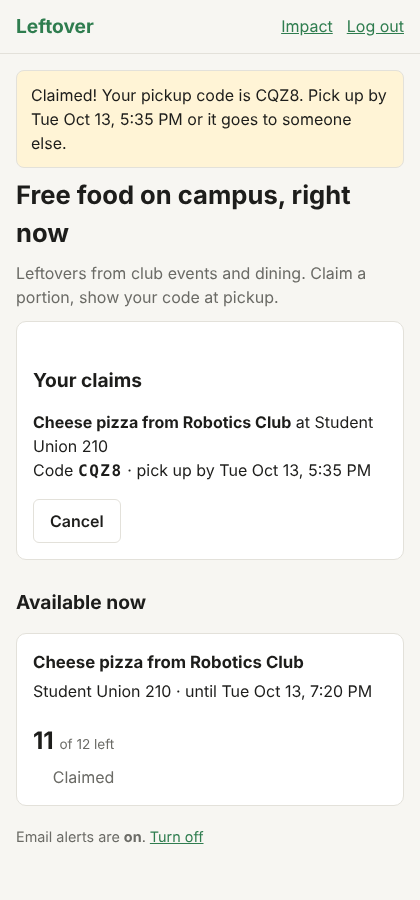
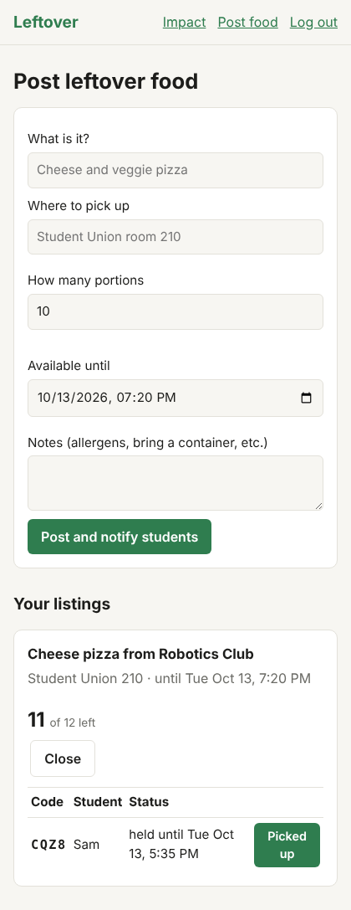
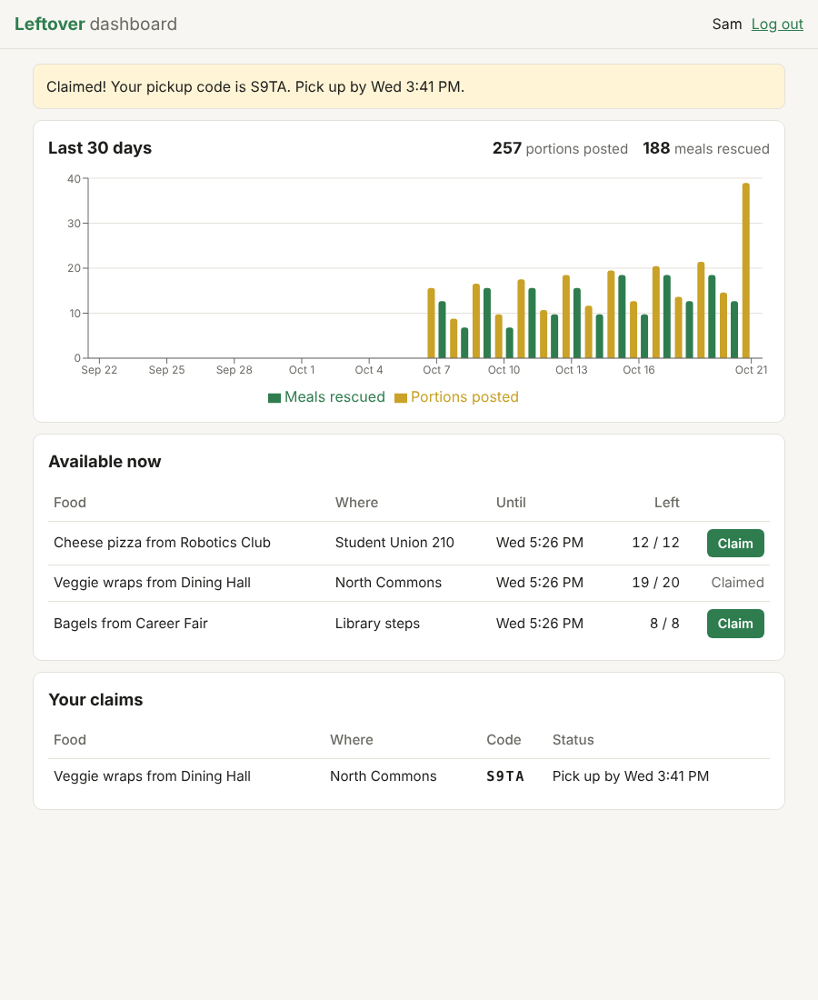

# Leftover: campus food rescue

A web app that matches surplus food from club events and dining halls with
students who want it.

- **Hosts** post leftover food: what it is, where, how many portions, and until when.
- **Students** see what's available, claim a portion, and get a 4-letter pickup code.
- A claim is a **hold that expires** (15 minutes by default). No-shows free the portion up for someone else.
- **Two students can never get the same last portion.** Claims lock the listing's database row, so they run one at a time (see `app/claims.py`, proven by `tests/test_claims.py::test_many_students_race_for_the_last_portion`).
- **Optional email alerts (off by default, since sending to everyone costs money):** set `EMAIL_ALERTS=on` to email students about new food, fewest-pickups-this-week first (`app/notify.py`).
- **Public impact page** at `/stats`: meals rescued, students fed, and so on.
- **JSON API with JWT login** under `/api` (interactive docs at `/docs`), used by a **React dashboard** with a chart of meals rescued over time.
- **Observability:** every request is logged as JSON (timestamp, endpoint, status, response time), optionally shipped to Datadog. `/health` checks the app and database.
- **CI/CD:** GitHub Actions runs the tests, builds both Docker images, smoke-tests the stack, and publishes the images on every push to `main`.

Stack: Python (FastAPI), Postgres, React (Vite), Docker, GitHub Actions. Deploys to Azure Container Apps ([docs/AZURE.md](docs/AZURE.md)) or Render.


| Student view | Host view |
|---|---|
|  |  |

React dashboard (shown with sample data):



## Run everything with Docker

```bash
docker compose up --build
```

- React dashboard: http://localhost:3000
- Main site: http://localhost:8000 (API docs at http://localhost:8000/docs)

## Quick start without Docker

```bash
createdb leftover && createdb leftover_test
python3 -m venv .venv && source .venv/bin/activate
pip install -r requirements-dev.txt
cp .env.example .env            # then edit SECRET_KEY
uvicorn app.main:app --reload --env-file .env    # http://localhost:8000
pytest

# React dashboard (second terminal; needs Node.js 22)
cd frontend && npm install && npm run dev       # http://localhost:5173
```

## API

| Method | Endpoint | Login needed | What it does |
|---|---|---|---|
| POST | `/api/token` | no | Log in with email + password, get a JWT (valid 60 minutes) |
| GET | `/api/listings` | no | Food available right now, with portions left |
| GET | `/api/stats/daily?days=30` | no | Portions posted and meals rescued per day |
| GET | `/api/me` | **yes** | The logged-in user |
| GET | `/api/me/claims` | **yes** | Your active claims and pickup codes |
| POST | `/api/listings/{id}/claim` | **yes** | Claim one portion (`409` if it's gone or you already have one) |

Send the token as `Authorization: Bearer <token>`.

## Project layout

```
app/
  main.py       web pages and form handlers (the routes)
  api.py        JSON API and JWT login
  observability.py  request logging (and optional Datadog shipping)
  claims.py     claiming, expiry, pickup: the concurrency-safe part
  notify.py     who gets alerted first, and sending email
  auth.py       password hashing, login checks
  models.py     database tables
  db.py         database connection
  templates/    HTML pages
  static/       CSS
tests/          pytest tests (run against real Postgres)
frontend/       React dashboard (Vite), its Dockerfile and nginx config
Dockerfile      backend image
docker-compose.yml   database + backend + frontend in one command
.github/workflows/ci.yml   tests, builds and publishes on every push
render.yaml     one-click deploy setup for Render
```
